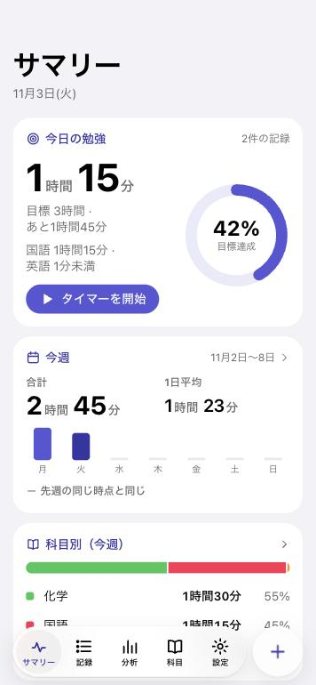
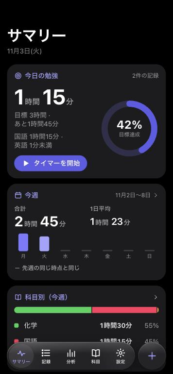
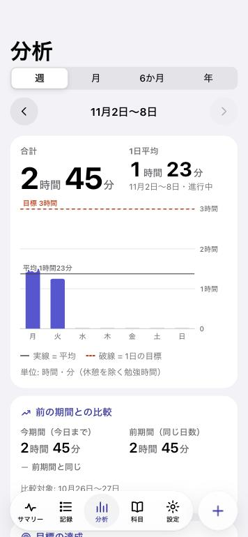
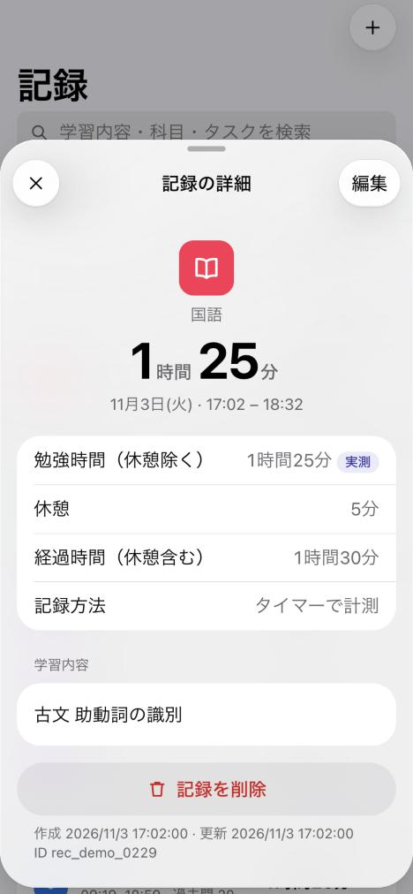

# Study Tracker — Apple Health × Liquid Glass

勉強時間を記録・分析する学習トラッカーの再設計版です。Apple Health の情報設計（カード単位のサマリー → 詳細グラフ）と Liquid Glass の考え方（操作レイヤーだけをガラスにする）を取り入れ、**既存データを壊さずに Muse のアーティファクトへ移植できる**こと、**AI エージェントが記録を正確に読んで分析できる**ことを目的に作られています。

## 使い方（claude.ai 版）

**アプリ: https://claude.ai/artifact/CDUr23YzmeaD6UtMaRaaAw** （本人のみ閲覧可）

- 記録は claude.ai の本人専用ストレージ（`data/users/<id>/tracker`）に保存され、iPhone と Mac など端末間で同期します。
- サマリーの「Claude のコメント」で、Claude が直近4週間の記録を読んでコメントします。「質問する」から記録について相談できます。
- Claude Code / claude.ai の会話で「勉強記録を見てコメントして」と頼むと、同じデータを読み取って分析できます（読み取りのみ。書き換えは承認制）。
- `dist/artifact.html` を `npm run build:artifact` で生成し、Artifact として公開しています。GitHub Pages など claude.ai 以外で開いた場合はこのブラウザに保存され、Claude の機能は表示されません。

> Muse へ統合する場合の資料（[`MUSE_HANDOFF_PROMPT.md`](MUSE_HANDOFF_PROMPT.md) ほか）も残しています。

| ライト | ダーク | 分析 | 記録の詳細 |
|---|---|---|---|
|  |  |  |  |

（画面のデータはすべて架空の合成データです）

## 機能

- **サマリー**: 今日の勉強時間と目標リング、今週の合計・1日平均・前週同時点比、科目別配分、連続日数、今週の計画達成率、直近8週の推移、直近の記録
- **記録**: 日付別の一覧、検索（学習内容・科目・タスク）、科目・期間の絞り込み、追加・編集・詳細・削除（元に戻せる）
- **タイマー**: 開始／休憩（一時停止）／再開／終了。勉強時間（休憩除く）と経過時間（休憩込み）を区別。再読み込みしても計測継続。計測中はタブバー上にアクセサリ表示
- **分析**: 週・月・6か月・年の棒グラフ（平均線・目標線、バー選択で値表示、キーボード操作可）、前期間比較、目標達成日数、科目配分、計画と実績、科目ごとの増減
- **科目**: 累計・今週・今月、週の目標、8週の推移、タスク管理、アーカイブ
- **設定**: テーマ（自動/ライト/ダーク）、ガラス効果（標準/不透明）、1日の目標、週の始まり、JSON/CSV/Markdown 書き出し、JSON/CSV 読み込み（マージ）、バックアップと復元、整合性チェック、削除した記録
- **Claude のコメント・相談**: claude.ai 上で Claude が記録を読み、事実と解釈を分けてコメント（`src/features/coach.ts`）
- **AI 連携**: 読み取り API `window.studyTracker`、DOM 内 JSON スナップショット、AI 用 Markdown レポート、承認制の変更提案
- **Liquid Glass**: 色の滲む壁紙の上に、すりガラスのカード、屈折するタブバー・サイドバー・シート、選択位置へ移動するレンズ（自作 Molecule アプリのエンジンを移植。`src/design-system/liquid-glass.ts`）

## 実行方法

```bash
npm install
```
```bash
npm run dev        # 開発サーバー（http://localhost:5173）
```
```bash
npm test           # 単体テスト（30件）
```
```bash
npm run build      # dist/index.html（単一ファイル・外部依存なし）を生成
```
```bash
npm run contrast   # 色コントラスト検証
```
```bash
npm run fixtures   # 合成フィクスチャ再生成
```

`dist/index.html` はリポジトリに同梱しています（Muse 側でビルドできない場合にそのまま使えるように）。ブラウザで直接開いても動作します。

## 技術スタック

TypeScript（strict）／フレームワークなし（安全なタグ付きテンプレート＋イベント委譲）／Vite 6 + vite-plugin-singlefile／Vitest。実行時依存ゼロ。理由は [`docs/ARCHITECTURE.md`](docs/ARCHITECTURE.md)。

## ドキュメント

| ファイル | 内容 |
|---|---|
| [`MUSE_HANDOFF_PROMPT.md`](MUSE_HANDOFF_PROMPT.md) | **Muse に渡す専用プロンプト** |
| [`docs/MUSE_MIGRATION.md`](docs/MUSE_MIGRATION.md) | 既存アーティファクトへの統合手順（調査→バックアップ→対応付け→検証→実装→実データテスト→ロールバック） |
| [`docs/DATA_SCHEMA.md`](docs/DATA_SCHEMA.md) / [`docs/schema/study-dataset.schema.json`](docs/schema/study-dataset.schema.json) | データモデル（型・単位・意味・必須） |
| [`docs/AI_DATA_GUIDE.md`](docs/AI_DATA_GUIDE.md) | AI が記録を読むための説明書 |
| [`docs/AGENT_INSTRUCTIONS.md`](docs/AGENT_INSTRUCTIONS.md) | AI の分析ルールと禁止事項 |
| [`docs/ARCHITECTURE.md`](docs/ARCHITECTURE.md) | 層構造と責務 |
| [`docs/DESIGN_SYSTEM.md`](docs/DESIGN_SYSTEM.md) | トークンとコンポーネント仕様 |
| [`docs/DESIGN_RESEARCH.md`](docs/DESIGN_RESEARCH.md) | Apple HIG / Liquid Glass の調査記録と設計判断 |
| [`docs/TEST_REPORT.md`](docs/TEST_REPORT.md) | 実施したテストと未実施の項目 |

## リポジトリ構成

```
src/
  app/            シェル（ナビゲーション・シート・トースト・テーマ）
  features/       画面（サマリー/記録/分析/科目/設定）とシート
  components/     html テンプレート、グラフ、共通UI
  design-system/  tokens.css / glass.css / base.css / components.css / icons.ts
  data/           スキーマ・正規化・ストア・整合性・入出力・合成データ
  analytics/      集計（純関数）と表示フォーマット
  adapters/       保存アダプター・既存データ変換・AI API・AI レポート
tests/            単体テスト
fixtures/synthetic-data/  架空データ（JSON / CSV / Markdown / フィンガープリント）
docs/             仕様書・スクリーンショット
dist/index.html   ビルド済み単一ファイル
```

## データの安全性

- 保存は端末内（localStorage の `sah:v1:*` キーのみ）。他のキーは読まない・消さない。
- 読めない保存データがある場合は読み取り専用で起動し、上書きしない。
- 削除はソフトデリート。インポート・復元・サンプル読込の前と、毎日最初の保存時に自動バックアップ（最新20件）。
- 未知のフィールドは捨てずに保持。
- このリポジトリに実データ・個人情報・秘密情報は含まれていません（フィクスチャは架空データ）。

## 注意事項

- Muse の既存アーティファクトの実データ・スキーマは、本リポジトリ作成時に**参照できていません**。統合時は Muse 側で必ず実データを調査してください。
- Liquid Glass は Apple ネイティブの素材で、Web では CSS による**近似**です。
- SF Symbols・SF Pro はライセンス上 Web に同梱できないため、独自アイコンとシステムフォント指定を使っています。
